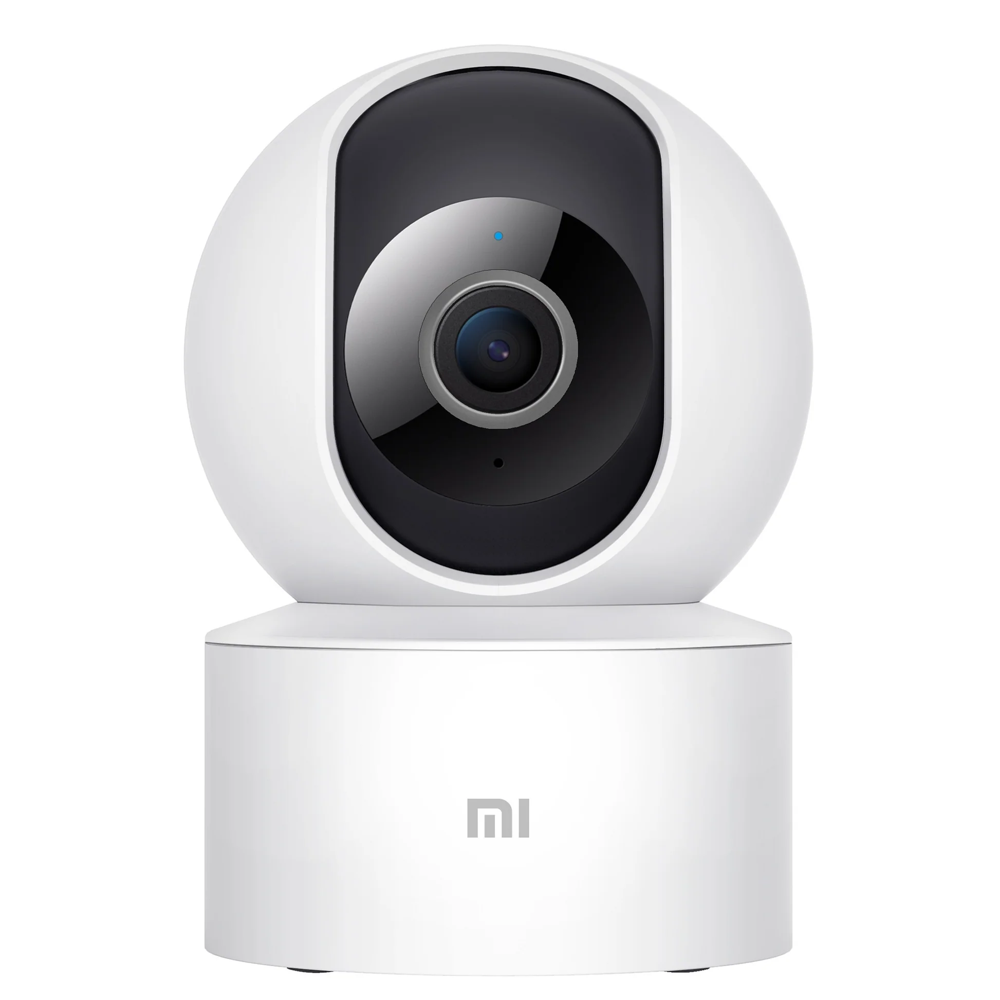
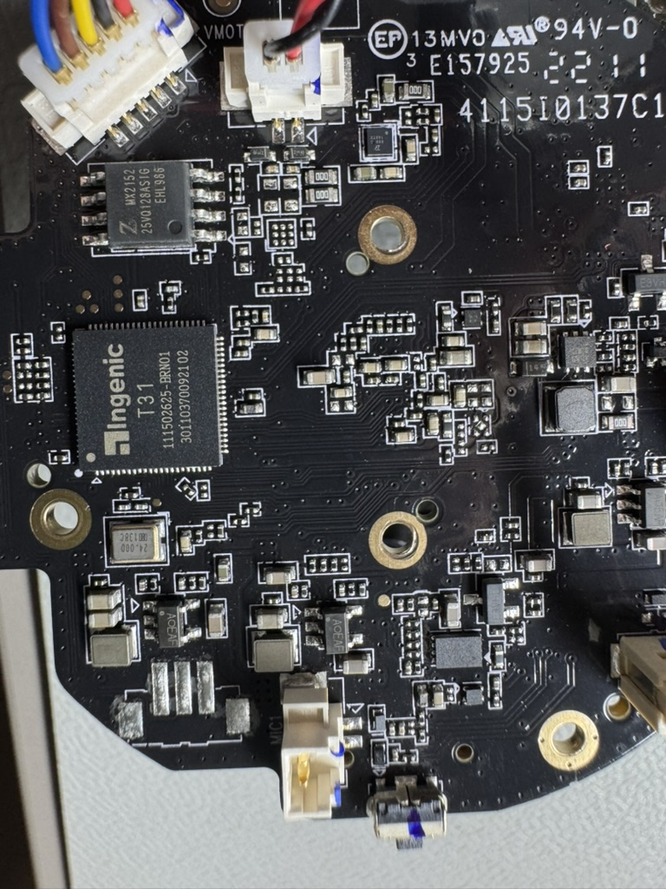

# Mi 360° Camera (1080p) — MJSXJ10CM



[Build the SSH image](root-access.md) · [ESP32 programmer setup](spi-programmer.md) ·
[SSH findings](#root-ssh) · [Boot and recovery limits](#boot-and-recovery)

**Tested:** MJSXJ10CM, factory model `chuangmi.camera.046a01`, running
`4.3.4_0376` on Ingenic T31 / SC2336 hardware. Other Mi 360 models and sensor
variants need separate inspection.

## Hardware



The Ingenic T31 is the large square package; the eight-pin Zbit flash is above it.

| Part | Observed value |
|---|---|
| SoC | Ingenic XBurst T31; MIPS32r2 little-endian, O32 ABI |
| Sensor | SC2336, confirmed through `/proc/jz/sinfo/info` |
| Flash | Zbit ZB25VQ128ASIG, 128 Mbit / 16 MiB SPI NOR, SOP-8 |
| OS | Linux `3.10.14__isvp_swan_1.0__`, Buildroot 2017.08, uClibc 0.9.33.2 |
| Filesystems | SquashFS / XZ for system/application/sound; 256 KiB JFFS2 DATA |
| microSD mount | `/mnt/sdcard`; SSH does not depend on a card |

[Xiaomi's model specifications](https://www.mi.com/uk/product/mi-360-camera-1080p/specs/)
list 1920×1080, 2.4 GHz Wi-Fi b/g/n, microSD up to 32 GB and 5 V / 2 A power.
Normal USB power-up did not expose a webcam, storage device or shell in the
observed boot state.

## Root SSH

A stock-derived application image with static Dropbear accepted public-key root
login on real hardware. Installation used an external SPI programmer, followed
by Wi-Fi setup. The [repeatable build guide](root-access.md) and
[offline tools](../../../tools/mi-360) rebuild the stock-derived image from your
own original dump, release source and public key. Firmware and compiled binaries
are not distributed here. The exported builder is checked offline; its output
has not been used for another hardware flash.

The modification:

1. Preserved the original full-chip dump and changed only B_USRFS.
2. Added static Dropbear 2026.94 and a late startup hook, retaining vendor services.
3. Stored the SSH home, authorized key and persistent host key under
   `/mnt/data/root-ssh`, with the home bound onto `/root`.
4. Disabled password authentication and forwarding in the server build.

Independent full-chip readback matched the prepared image before boot. Live
B_USRFS readback also matched, and SSH returned UID 0. Isolated QEMU checks covered
key login, terminal allocation, wrong-key/password refusal and host-key retention
across a daemon restart. That restart check does not establish cold-boot persistence.
Vendor OTA remains present and can replace the patched application slot.

### Inspect an already-rooted camera

Requires working root SSH and your authorized private key. These commands do not
install SSH on stock firmware. Replace `SSH_PRIVATE_KEY` and `CAMERA_HOST`:

```sh
ssh -i SSH_PRIVATE_KEY root@CAMERA_HOST '
  id
  uname -r
  cat /proc/jz/sinfo/info
  cat /proc/mtd
  mount
'
```

On the tested image, expect UID 0, sensor `sc2336`, nine MTD partitions,
`/dev/mtdblock5` at `/mnt/usr` and `/dev/mtdblock6` at `/mnt/data`.
Keep vendor services and watchdogs running while inspecting the device.

## Boot and recovery

The original dump contains stock A `4.1.6_0188` and selected B `4.3.4_0376`.
Each slot has its own kernel and application filesystem; BOOT, ROOTFS, DATA,
SOUND and FACTORY are shared.

- `bootcmd` selects the kernel; `boot_flag` selects the application slot. They must agree.
- The stored U-Boot environment is 32 KiB at `0x48000` inside BOOT. Only one valid
  copy has been established.
- Batching settings into one `fw_setenv` transaction does not make the NOR erase
  and write atomic. Power loss can destroy boot selection while both slots remain intact.
- Older built-in defaults use a different partition map. Automatic rollback or
  fallback boot has not been demonstrated.
- UART boot arguments name `ttyS1` at 115200 8N1; physical pins and UART recovery
  are unverified. Keep original dumps and external-programmer access for recovery;
  restoration of the original dump has not been rehearsed.

The prepared inactive-slot updater was checked offline, but remote staging and
activation have not been exercised on the camera. Its first update from B would
replace the older A recovery build.

Cold power-cycle persistence, RTSP/ONVIF, video, audio, motor/IR control and a
complete replacement firmware remain unverified. Device nodes and running stock
processes alone do not establish that these functions work.
