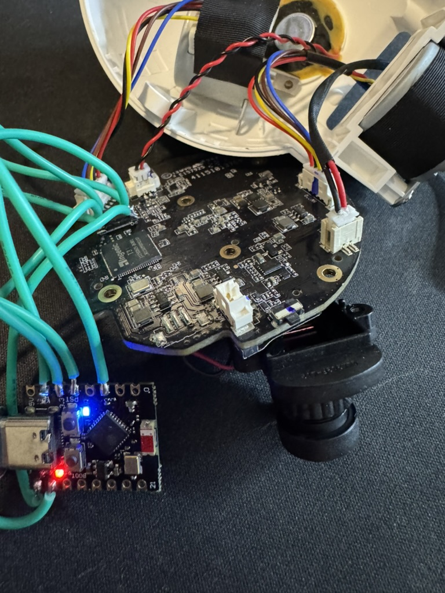

# Mi 360 SPI flash programmer — ESP32-C3 SuperMini

[Model and SSH findings](README.md)



The setup used an ESP32-C3 SuperMini running patched
[picoprog](https://github.com/9elements/picoprog/tree/32402dd) `esp32c3-prog`,
with `flashrom 1.8.0` on the computer speaking the serprog protocol over USB.
Six wires were soldered directly to the Zbit ZB25VQ128ASIG flash pins.

## Wiring

Disconnect the camera's USB power before connecting the programmer.
Use the ESP32 board's **3.3 V**, never its 5 V pin. Flash pin 1 is marked by the
package's round dot; use SOP-8 pin numbering rather than the photo's orientation.

| Signal | ESP32-C3 SuperMini | Flash pin |
|---|---|---|
| CS | GPIO5 | 1 — CS |
| MISO | GPIO4 | 2 — DO |
| Ground | G | 4 — GND |
| MOSI | GPIO2 | 5 — DI |
| Clock | GPIO6 | 6 — CLK |
| Power | 3.3 | 8 — VCC |

WP (3) and HOLD (7) were left connected to the target board's pull-ups.

**VCC isolation was necessary on this board.** Initial in-circuit reads returned
only `0xff`: programmer power also woke the T31, which drove the shared SPI bus.
Lifting flash pin 8 off its PCB pad and feeding that pin from the programmer
isolated the flash supply and allowed reads. The programmer and flash still
shared ground. Resolder pin 8 to its pad before normal camera power-up.

## Programmer firmware caveat

The working firmware was based on picoprog commit `32402dd` with a local patch;
the patch and compiled programmer are not included here. This page records the
wiring and observations, rather than a complete programmer build/install recipe.

Unmodified firmware at that revision read successfully but repeatedly hung after
the first erased block during a write. The diagnosed cause was a missed wake-up
in esp-hal 1.1.1's asynchronous USB transmit path. The working patch switched
transmit to blocking `embedded_io::Write::write_all` plus `flush`, read incoming
buffers to their full length, and read the serprog SPI operation's six-byte
header separately from its payload. Do not assume the unmodified revision is
safe for writing based on a successful read.

## Probe and back up

Requires a programmed ESP32-C3, the wiring/isolation above, and `flashrom`.
Replace `PROGRAMMER_PORT` with your board's serial device. Use new output names
so earlier backups remain intact.

```sh
flashrom -p serprog:dev=PROGRAMMER_PORT,spispeed=4M
flashrom -p serprog:dev=PROGRAMMER_PORT,spispeed=4M -r backup-1.bin
flashrom -p serprog:dev=PROGRAMMER_PORT,spispeed=4M -r backup-2.bin
cmp backup-1.bin backup-2.bin
wc -c backup-1.bin backup-2.bin
```

Expected: JEDEC `5e 40 18`, reported by that flashrom version as an unknown
SFDP-capable 16384 kB chip; two 16,777,216-byte files; `cmp` exits successfully
with no output. A complete read took about 44 seconds at 4 MHz.
If detection or either comparison fails, resolve power, isolation, wiring or
transport issues before considering a write.

The tested setup ultimately wrote the stock-derived SSH image, and an independent
full-chip readback matched it byte for byte. No image is distributed here: retain
your own original dump, including factory data, and do not substitute another
camera's full-chip image. Flashrom's final verification can be a silent full-chip
read; silence alone is not evidence that it has hung.
