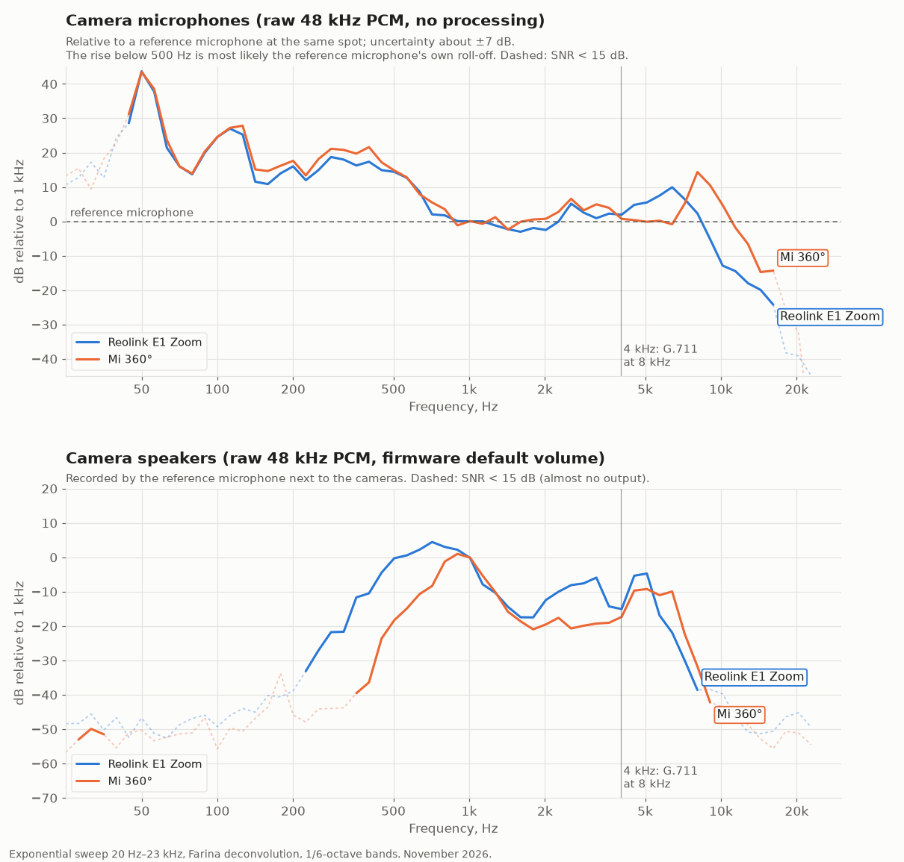

# Microphone and speaker frequency response: Reolink E1 Zoom and Mi 360°

What the camera audio hardware can carry when the codec does not limit it. Measured in November 2026 on one
[Reolink E1 Zoom](../devices/reolink-e1-zoom/README.md) and one [Mi 360°](../devices/mi-360/README.md),
both running the [replacement firmware](../../firmware/README.md).

## Results

Values are relative to the 1 kHz level.

| | Reolink E1 Zoom | Mi 360° |
|---|---|---|
| Rates tested | mic 48 kHz, speaker 16/32/48 kHz; HDAL `SYSCAPS` reports 8–48 kHz | mic 48 kHz, speaker 16/48 kHz |
| Microphone vs reference mic, 500 Hz up | within ±10 dB to ~8.5 kHz; −13 dB at 10 kHz, −24 dB at 16 kHz | within ±15 dB to ~11 kHz; −14 dB at 16 kHz, −33 dB at 20 kHz |
| Speaker, within −20 dB | ~350 Hz–5.7 kHz; −39 dB at 8 kHz | ~500 Hz–6.4 kHz; −32 dB at 8 kHz |

- Two-way audio over G.711 (PCMU) at 8 kHz is limited to 4 kHz by the codec, not by this hardware.
- The microphones carry usable signal beyond 8 kHz; the speakers do not, so 16 kHz sampling covers them.
- Neither speaker produces useful output below ~300 Hz.

## Method

The procedure is the standard exponential-sweep (Farina) measurement; any sweep and deconvolution tool works
(for example Python with SciPy). Only the camera-side capture and playback loop is camera-specific.

1. Stop the camera daemon and run a RAM-only program that reads and writes raw 16-bit mono PCM at 48 kHz
   through the vendor SDK, writes captures to a file in RAM and plays a raw file; copy the files over SSH.
   - Reolink: `hd_audiocap_pull_out_buf` / `hd_audioout_push_in_buf`, AEC and ANR off, mic volume 80,
     speaker volume 100 (the firmware's defaults), amplifier GPIO 234 high.
   - Mi 360°: `IMP_AI_GetFrame` / `IMP_AO_SendFrame`, no NS/AEC/AGC, mic volume 55 / gain 20,
     speaker volume 54 / gain 28 (the firmware's defaults), `/dev/speaker` enabled.
2. Place both cameras and a reference microphone side by side, capsules facing the same way.
3. Microphones: play a 6 s sweep (20 Hz–23 kHz) from a soundbar (used below 2 kHz) and from laptop speakers
   (used above 2 kHz), record all three microphones at once, divide each camera's response by the reference's.
4. Speakers: each camera plays the same sweep at −30 dBFS; the reference microphone records it.
5. Deconvolve, average in 1/6-octave bands and normalise to 1 kHz. Bands under 15 dB SNR are dashed.

The camera-side program is not part of this repository.

## Limits

- The reference microphone is not calibrated. Its high end was checked against laptop speakers (flat to
  20 kHz within ±5 dB); its low end was not. Below 500 Hz the microphone curves are not valid: the rise
  there is most likely the reference microphone's roll-off.
- The two sweep sources disagree by about 7 dB between 1 and 4 kHz on both cameras: treat ±7 dB as the
  microphone uncertainty.
- The speakers are directional. With the reference microphone farther away, the Mi 360° speaker read −10 dB at
  8 kHz instead of −32 dB. The curves describe this arrangement, not an anechoic measurement.
